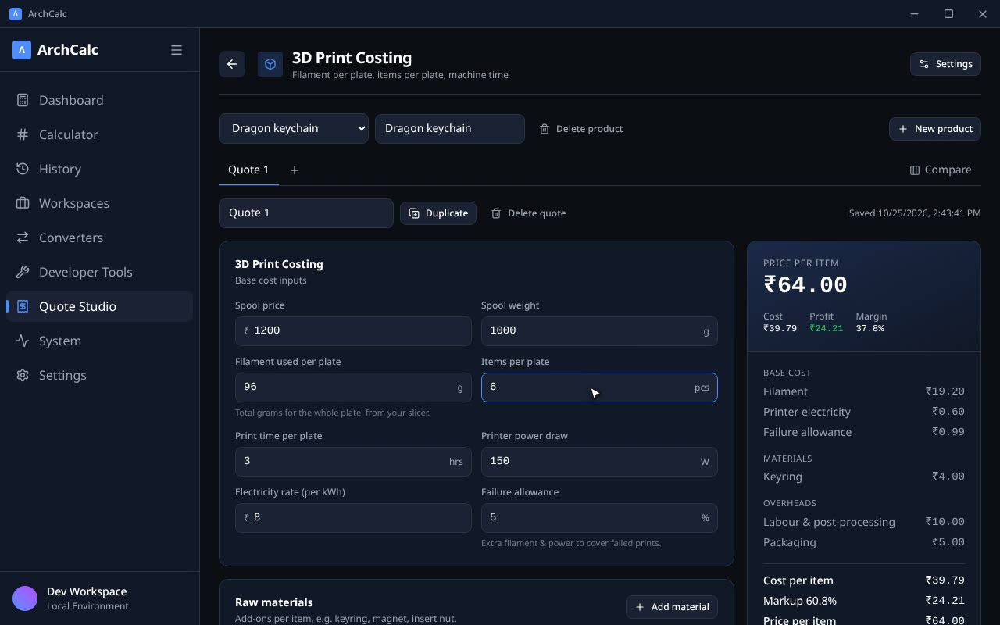
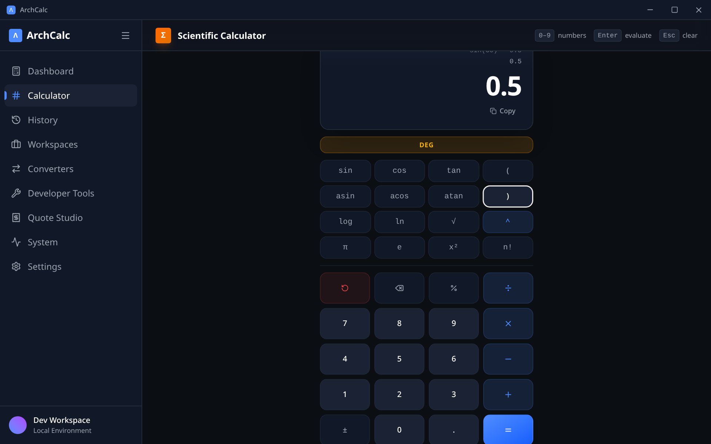
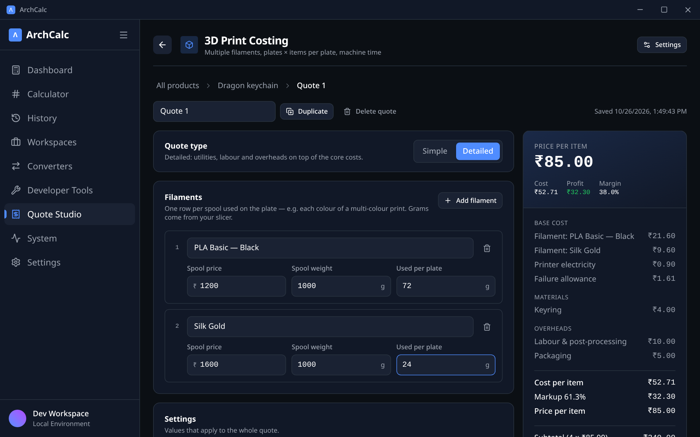
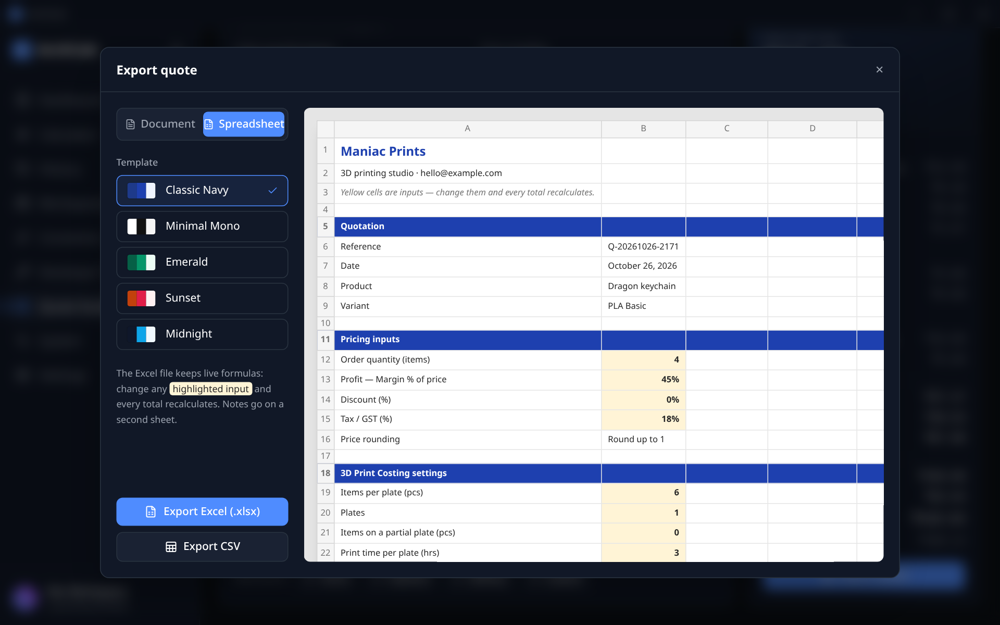

<div align="center">


# ArchCalc

**A fast, lightweight desktop calculator and everyday toolkit — built with Rust, Tauri and SolidJS.**

[Website](https://arch-calc-five.vercel.app) ·
[Documentation](https://arch-calc-five.vercel.app/docs) ·
[Download](https://github.com/murtazapatel89100/ArchCalc/releases) ·
[Report a bug](https://github.com/murtazapatel89100/ArchCalc/issues/new?template=bug_report.md)

[](https://github.com/murtazapatel89100/ArchCalc/actions/workflows/ci.yml)
[](https://github.com/murtazapatel89100/ArchCalc/releases)
[](https://aur.archlinux.org/packages/archcalc)
[](LICENSE)



</div>

## Features

- **Command bar** — type maths, unit conversions (`5 km to mi`), percentages (`18% of 4999`) or developer commands (`uuid`, `sha256 text`, `base64 encode text`, `now`) in one box. <kbd>Ctrl</kbd>+<kbd>Space</kbd> jumps back to it from anywhere.
- **Scientific calculator** — trigonometry and inverses, logarithms, roots, powers, factorial, π and e, with a DEG/RAD toggle. Expressions are parsed and evaluated by a custom Rust AST engine.
- **History** — every result is saved locally and searchable, with configurable retention.
- **Workspaces** — notepad-style sheets where each line is calculated live; assign variables and reuse them.
- **Converters** — length, weight, temperature and storage.
- **Developer tools** — hash generator, UUIDs, timestamps, Base64, JSON formatter, binary, hex and storage conversions.
- **System monitor** — live CPU, memory, swap and network charts.
- **Quote Studio** — cost and quote builders for 3D printing (multiple filament spools and plates), freelancing, baking, tailoring, handmade crafts, catering, printing and home painting.
  - Organise work as **products**, each with several **quotes** you can duplicate and compare.
  - Repeatable rows (spools, fabrics, surfaces, menu items), raw materials, overheads, five profit methods, discount, tax and rounding.
  - **Simple** quotes for just the core costs, or **Detailed** quotes with utilities, labour and overheads.
  - Markdown **notes & terms** sections.
  - Export branded **PDF**, **Word** or **Markdown** quotes in five templates — or a **live Excel spreadsheet** whose formulas recalculate when you change an input. CSV too.
- **Your data stays on your machine** — no account, no telemetry. Export and import everything from Settings.

| Calculator | Quote Studio | Spreadsheet export |
| :-: | :-: | :-: |
|  |  |  |

A two-minute tour of every feature is on the [website](https://arch-calc-five.vercel.app) and in the [docs](https://arch-calc-five.vercel.app/docs/features).

## Install

| Platform | How |
| :-- | :-- |
| **Arch Linux** | `yay -S archcalc` (or any AUR helper) |
| **Debian / Ubuntu** | `.deb` from [Releases](https://github.com/murtazapatel89100/ArchCalc/releases) |
| **Fedora / RHEL** | `.rpm` from [Releases](https://github.com/murtazapatel89100/ArchCalc/releases) |
| **Windows** | `.msi` or `.exe` installer from [Releases](https://github.com/murtazapatel89100/ArchCalc/releases) |
| Flatpak | Coming soon |

> **Windows SmartScreen:** ArchCalc isn't code-signed yet, so Windows may show an "Unknown Publisher" warning the first time. Choose **More info → Run anyway**. See [Getting Started](https://arch-calc-five.vercel.app/docs/getting-started) for details.

## Repository layout

This is a pnpm monorepo with two independent projects:

| Path | What | Stack |
| :-- | :-- | :-- |
| [`app/`](./app) | The desktop application | Tauri 2 · Rust · SolidJS · Tailwind CSS 4 · Vite |
| [`web/`](./web) | Landing page and documentation site | Next.js · Fumadocs (MDX) · Tailwind CSS 4 |

See [`app/ARCHITECTURE.md`](./app/ARCHITECTURE.md) for how the app is put together.

## Development

**Prerequisites:** [Node.js](https://nodejs.org/) 20+, [pnpm](https://pnpm.io/) 11, the [Rust toolchain](https://rustup.rs/), and the [Tauri system dependencies](https://tauri.app/start/prerequisites/) for your OS.

```bash
# Desktop app
cd app
pnpm install
pnpm tauri dev        # run the app with hot reload
pnpm test             # unit tests (Vitest)
pnpm tauri build      # production bundles

# Website & docs
cd web
pnpm install
pnpm dev              # http://localhost:3000
```

Before opening a pull request, run the same checks as CI:

```bash
pnpm dlx @biomejs/biome check ./                                    # in app/ and web/
cd app/src-tauri && cargo fmt -- --check
cargo clippy --workspace --all-targets --all-features -- -D warnings
cargo test
```

## Contributing

Contributions are welcome — bug reports, features, docs and new Quote Studio builders alike. Please read the [Contributing Guide](CONTRIBUTING.md) and our [Code of Conduct](CODE_OF_CONDUCT.md). Commits follow [Conventional Commits](https://www.conventionalcommits.org/); releases and the [changelog](CHANGELOG.md) are generated by release-please.

AI coding agents should read [AGENTS.md](AGENTS.md) first.

Found a security issue? Please follow the [Security Policy](SECURITY.md) instead of opening a public issue.

## License

[MIT](LICENSE) © 2026 Murtaza Hakem Patel and contributors
